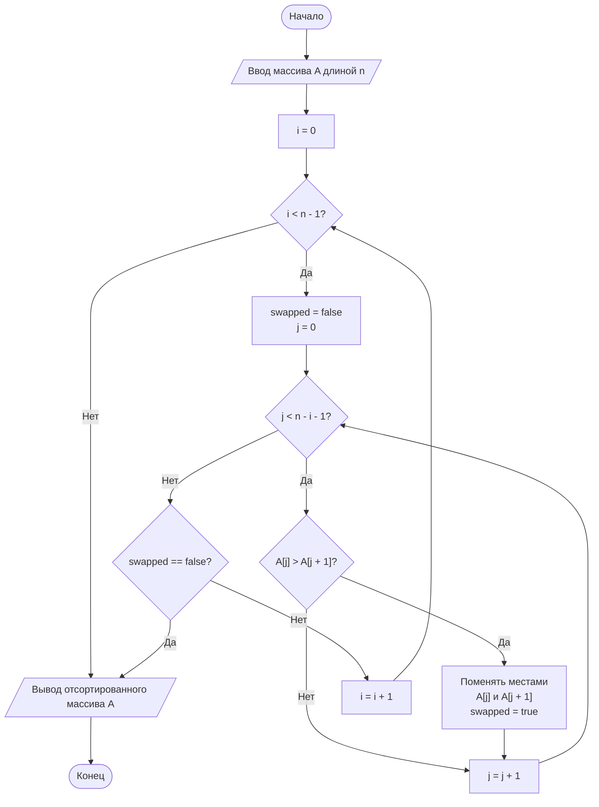

# 1. Алгоритм сортировки
## 1.1 Пузырьковый


|0|1|2|3|4|
|-|-|-|-|-|
|5|1|2|0|9|
|1|2|3|5|4|
|1|2|3|5|4|

```Java
System.out.print("Привет, ");
System.out.print("мир!"); // Вывод: Привет, мир!
```



